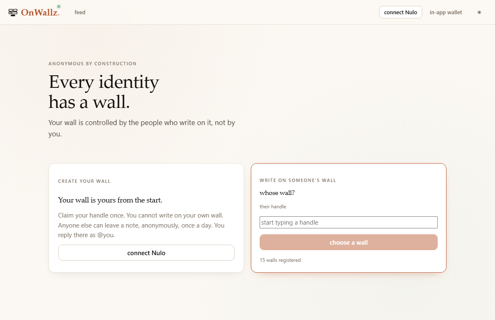
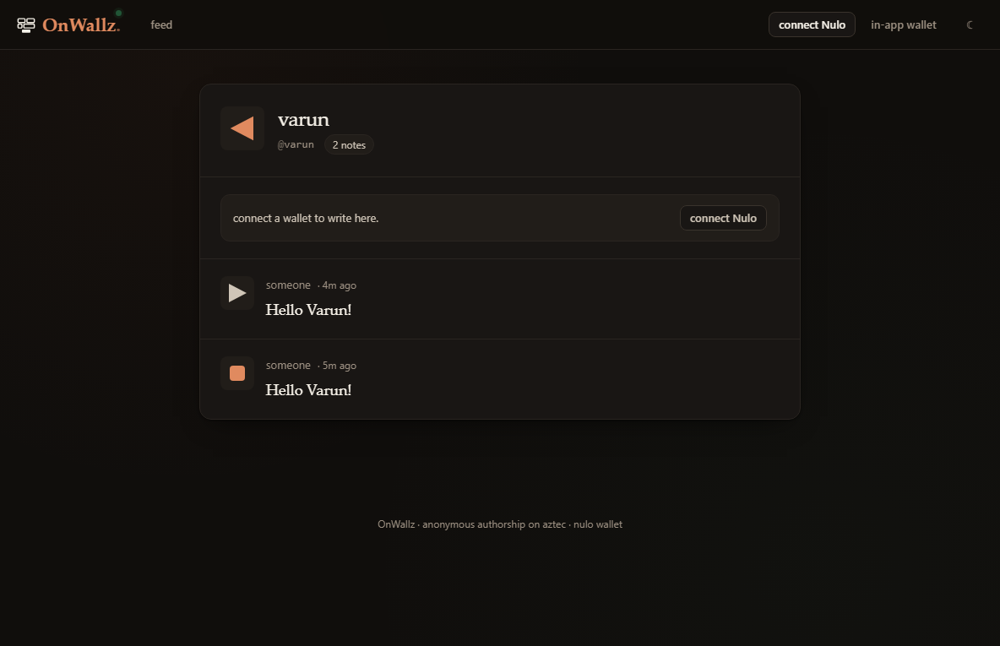

# OnWallz

Every handle gets a wall.

You create your own wall when you sign up. Anyone else can leave a note on it, once a day, with nothing attached that says who wrote it. You cannot write on your own wall. You can reply there, as yourself, and nothing on chain records who wrote any note.

Live on Aztec testnet: https://onwallz.vercel.app

> Your wall is controlled by the people who write on it, not by you.





## What it is

A public wall for a handle, and an anonymous note for anyone who visits it.

- connect a wallet, pick a handle, and the wall is yours
- anyone else may write on it, anonymously, once per day
- you reply on your own wall, signed, because it is the one place you are the owner
- you write anonymously on everyone else's wall

There is no signup, no email, no profile, no feed algorithm, no company holding the notes. The wallet is the account, and the chain is the database.

## Why the privacy is real

Most "private" social apps keep a database of who said what and promise not to look. OnWallz has no such database, because the contract has no field to put it in. Not a hidden field, not an admin-only one. The data does not exist.

Concretely:

**No author is written anywhere.** Not in storage, not in an event, not in the calldata sent from the private half to the public half. Compare the two halves:

```noir
// private: knows the caller, proves the rules, stores nothing identifying
fn write(text, length, nonce, name, name_len) { ... enqueue(_publish(...)) }

// public: receives no address, no key, no tag
fn _publish(wall, text, length, nonce, key, name) { ... }
```

The public half is the only part the world sees, and it is given a wall, some text, a random nonce and a hiding commitment. None of those is a person.

**Notes cannot be joined across walls.** The write limit is a nullifier of `poseidon2(secret, wall, day)`. Since the wall is part of the preimage, the same wallet posting on two walls produces two unrelated nullifiers. There is no shared value to correlate.

**Authorship can be proven later, by the author only.** Each note stores `post_key = poseidon2(secret, wall, nonce)`. Only the holder of the secret can reproduce it, which is what makes tombstoning your own note possible without revealing who you are.

**Ownership cannot be tested by guessing addresses.** A wall's ownership is a private note, and the note hash preimage includes secret randomness delivered only to the owner. The log that delivers it is tagged with a handshake secret that "no third party can compute", in the framework's own words. So an observer with a list of Aztec addresses cannot test which one owns `@alice`.

**The text is public, and that is the point.** Anonymous does not mean encrypted. Anyone can read the notes, verify their order, and check the wall's history. What nobody can read is the author.

## How it works

**Creating a wall.** `create(name, len)` runs privately, inserts an ownership note into your wallet, and enqueues `_create`, which sets the public facts: the name exists, it is taken, its display name, and a note count of zero. The chain learns that a name is taken, never by whom.

**Writing.** `write` runs privately. It refuses your own wall by reading your private notes, then pushes a nullifier scoped to `(wallet, wall, day)`, so the daily limit is enforced without becoming identity.

**Long notes.** A note holds up to 992 bytes. Up to 93 bytes the text lives in public storage, which keeps reads to a few slot lookups. Longer notes put their text in a `PostedLong` event and keep only length and a digest in state, so a long note costs a log instead of thirty storage slots. The text is still permanent chain data, just in the log rather than in state.

**Time.** The public half stamps every note with block time. The interface never invents a timestamp.

**Replies.** Only the owner can reply, proved from the private ownership note. The chain learns that the wall's owner replied, not which wallet that is.

**Search.** The home page builds a list of walls from `Created` events and their names from the public `display` map. Typing a prefix filters that local list, so only walls that exist can be opened or written to.

## Two ways to hold a wallet

**Nulo extension.** The recommended path. It keeps keys, proves transactions and manages your identity.

**An in-app wallet.** For phones and for anyone who will not install an extension. It creates keys in the page, stores them in this browser, and proves transactions on the device. Slower, since proving runs on your hardware, and the backup string it shows you is the only way to recover it. It can be exported, imported and forgotten from the same dialog.

On testnet, fees are paid by the sponsored payer, so neither wallet needs fee juice. That is a demo convenience, not the fee model.

## Stack

Aztec 6.0.0, Aztec.nr v6.0.0, Noir 1.0.0-rc.3. The client is Vite and React with no backend. Reads go straight from the browser to the node: public storage slots for the fast path, paginated event logs for long notes and the wall registry. Writes go through whichever wallet you chose, with a simulation before every send so a rejection comes back as a real reason instead of the wallet's catch all.

Contract: `onwallz_contract/src/main.nr`. Tests: `onwallz_test/src/lib.nr`, thirteen of them.

## Running it

```
source ~/.aztec-env.sh
cd onwallz_contract
aztec compile --workspace
TXE_WORKERS=1 aztec test
```

```
cd frontend
npm install
cp .env.testnet.example .env.local
npm run dev
```

The contract address is read from `frontend/public/contract.json` at boot, so a build points at whatever address that file contains.

## Status

Testnet. The wall model, anonymity, ownership notes, long notes, on-chain time, the in-app wallet and the registered-wall search are all live. Private fee juice is built and tested and stays behind the mainnet gate.

## What is not done

- private fees on mainnet, which is the remaining privacy gap
- handle verification, if first come ever becomes a real problem
- an indexer, which the log reads will want at real scale
- profiles, moderation, and every other thing a wall cannot do yet
