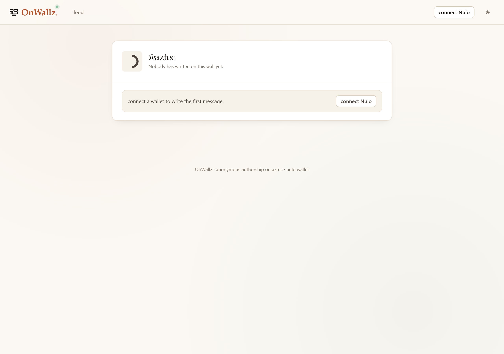

# OnWallz

Every handle gets a wall.

Anyone can write on someone else's wall, once a day, with nothing attached to the
message saying who sent it. The person behind the handle can claim it later and
answer what people left there. No signup, no email, no company in the middle
holding your posts. The wallet is the account.

> Your wall is controlled by the people who write on it, not by you.

Live on Aztec testnet: https://onwallz.vercel.app



## The idea

Most social apps ask you to make an account, then they keep your posts in a
database and decide who gets to read them. OnWallz goes the other way. The walls
are contracts, the notes are public storage, and nobody has a list of who wrote
what, because the contract never asks.

A wall is created by the first message someone leaves on that handle. There is no
"create a wall" button and no profile to fill in. If you want to see what people
said about you, search your handle. If nothing is there, nobody has written yet.

## Claiming and replying

Anyone can write on your wall. You cannot claim a wall unless somebody else has
already written there, which means a name with no messages can't be squatted.

When you claim, the contract stores a private note in your wallet and a single
public bit saying the name is taken. It does not store your address. The note is
the proof you own the name, and it stays in your wallet. Clearing your browser
does not lose it.

Claiming also has to prove you were not the one who wrote the notes already
there. The claim call carries the public nonce of every note on the wall, the
contract recomputes your author keys from them, and refuses if any of them match
a stored key. You cannot claim a wall you wrote on, and lying about a nonce gets
rejected too.

Only the owner can reply, because only the owner can produce that note. Replies
are public and one per note.

## Where anonymity actually comes from

There is no author field. Not in storage, not in events, not in the calldata sent
to the public half of the contract. A note is written by a private function that
proves a daily limit and derives a key, then hands the text to a public function
that knows nothing about the caller.

The contract does store a commitment per note, `poseidon2(secret, wall, nonce)`,
so the author can later prove they wrote it if they want to. Nobody else can open
it. That commitment is why deletion still works without revealing who is deleting.

What is public: the notes, the replies, the order they arrived in, and which
names are taken. What is not: who owns a name, and who wrote a note.

Two honest limits. Someone holding your keys can work out which notes are yours,
because the keys are what the commitment is built from. And until fees are paid
through the private fee contract, the transaction payer is visible. That last part
is the remaining gap before mainnet.

## Stack

Aztec 6.0.0, Aztec.nr v6.0.0, Noir 1.0.0-rc.3. The frontend is Vite and React,
with no backend. It reads walls and the feed straight from the node with
`getPublicStorageAt`, using the storage slots that ship inside the compiled
artifact. Nothing sits between the browser and the chain except the node itself.

Writes go through Nulo, which is where the proof is generated.

## Running it

```
source ~/.aztec-env.sh
cd onwallz_contract
aztec compile --workspace
TXE_WORKERS=1 aztec test
```

```
cd frontend
npm install
cp .env.testnet.example .env.local
npm run dev
```

The contract address is read from `frontend/public/contract.json` at boot, so a
build points at whatever address that file contains.

## Tests

13 tests, mostly about the rules that matter:

- a name cannot be claimed before anyone writes on it
- a name cannot be claimed twice
- you cannot claim a wall you wrote on
- you cannot label a wall with a name it does not belong to
- only the owner can reply
- writing on your own wall is refused
- a stranger can still write after a wall is claimed
- notes keep their text when tombstoned

## Still open

The private fee contract is built and tested, and it makes the payer the fee
contract instead of your wallet. It is switched off while this runs on testnet
with a sponsored payer. It goes on before mainnet.

Replies are a single field, so they are limited to about 31 bytes. Notes already
use three fields and can hold more.

The bundle ships the Aztec prover wasm even though the wallet does the proving,
which makes first load heavier than it needs to be.

## License

Not chosen yet. Ask before you build on it commercially.
